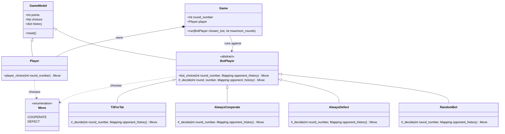

# Game Theory Simulator
A terminal-based repeated game where a human player chooses to cooperate or
defect against a bot. Each round, both choices are scored, totals accumulate,
and the game reports the winner after the configured number of rounds.
## UML class diagram

## How a game runs
`main.py` creates a `Game` and runs it against each included bot strategy.
For every round, `Game.run()` asks the player for a choice, asks the bot for
its choice using the player's history, and calls `assign_points()` in
`behaviour.py`. The `GameModel` base class tracks each participant's points
and move history; after the rounds, `declare_winner()` compares the totals.
| Choices | Player points | Bot points |
| --- | ---: | ---: |
| Both cooperate | 3 | 3 |
| Both defect | 1 | 1 |
| Player cooperates, bot defects | 0 | 5 |
| Player defects, bot cooperates | 5 | 0 |
The bots cooperate every time (`AlwaysCooperate`), defect every time
(`AlwaysDefect`), choose a random move (`RandomBot`), or copy the player's
previous move after cooperating on the first round (`TitForTat`).
## Run
With Python 3.12 or later, run:
```sh
python main.py
```
The default entry point plays 20 rounds against each bot in sequence. Enter
`C` or `D` when prompted for each player move.
